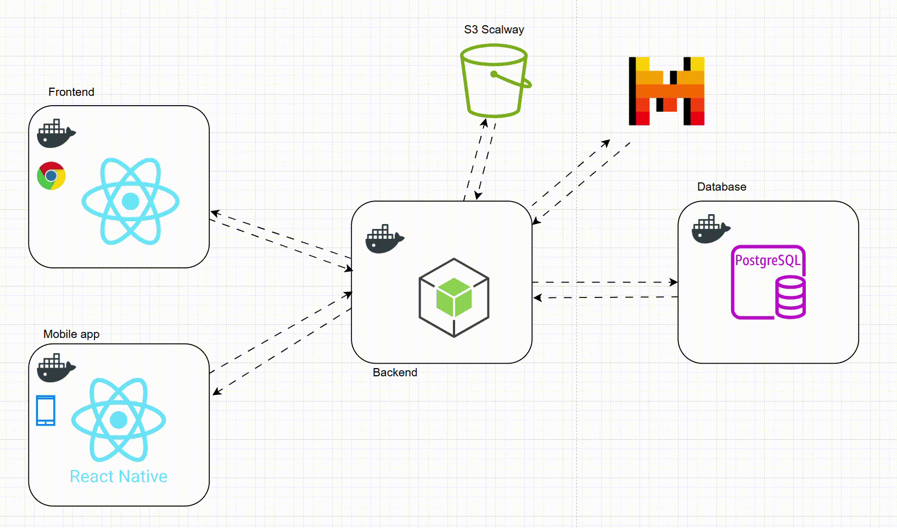
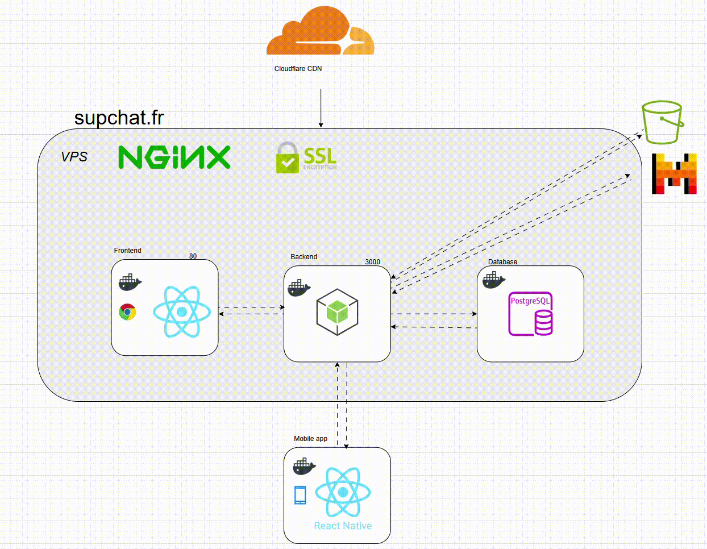
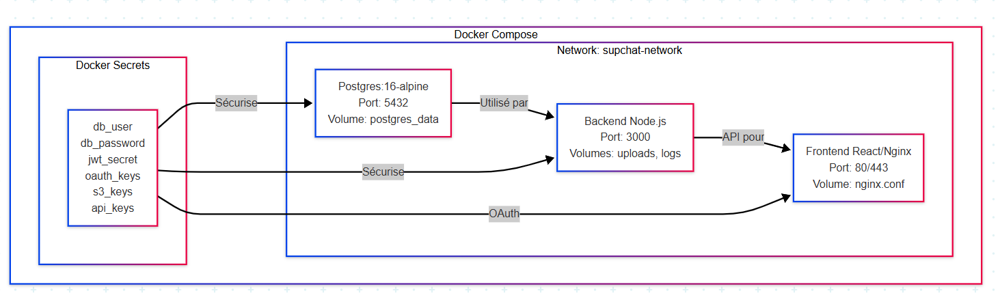
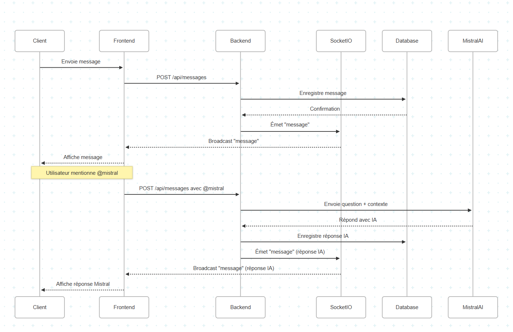
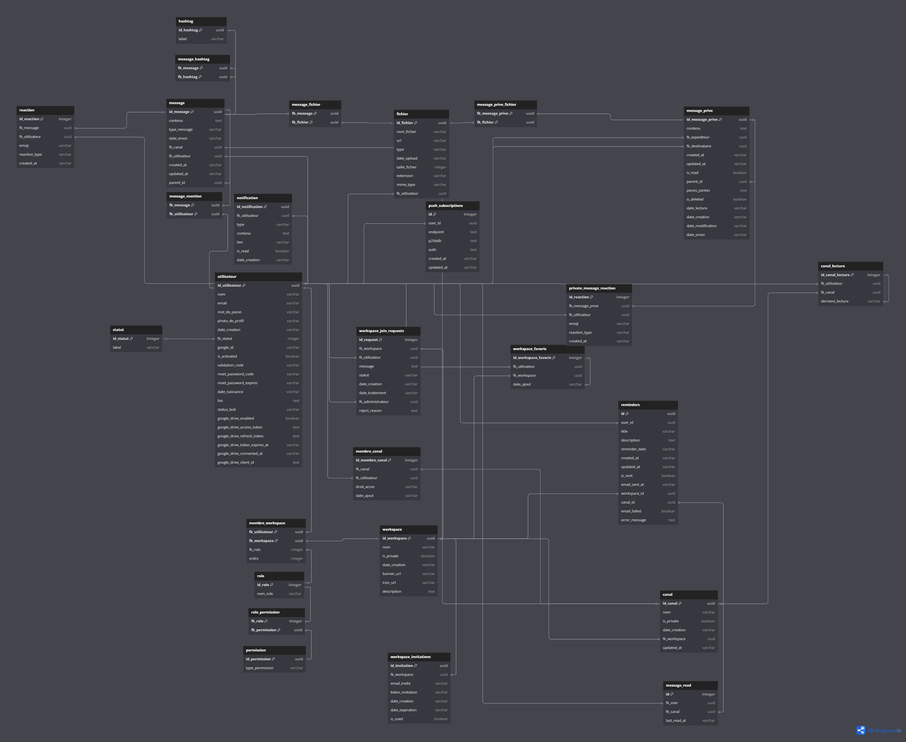
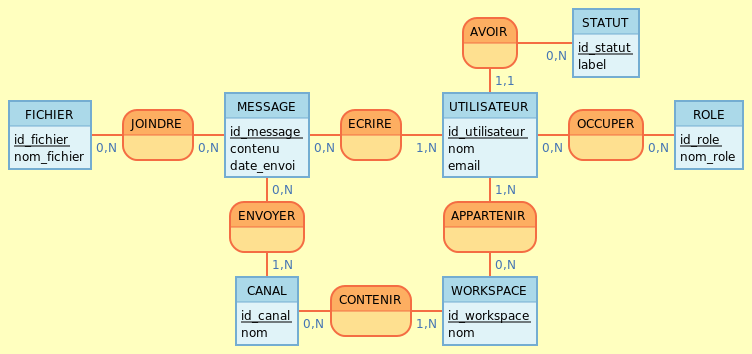

# 🚀 SUPCHAT

<div align="center">
  
  
  **Une plateforme de communication moderne multi-plateforme avec IA intégrée**
  
  **Accessible dès maintenant sur `https://supchat.fr/about.html`**
  
  [](https://nodejs.org/)
  [](https://reactjs.org/)
  [](https://reactnative.dev/)
  [](https://postgresql.org/)
  [](https://docker.com/)
  [](LICENSE)
</div>

---

## 📋 **Table des Matières**

- [🎯 Vue d'Ensemble](#-vue-densemble)
- [✨ Fonctionnalités](#-fonctionnalités)
- [🏗️ Architecture](#️-architecture)
- [🛠️ Technologies](#️-technologies)
- [🚀 Installation](#-installation)
- [🐳 Guide de Déploiement Docker](#-guide-de-déploiement-docker)
  - [🔐 Secrets Docker - Configuration Essentielle](#-secrets-docker---configuration-essentielle)
- [📱 Application Mobile (React Native)](#-application-mobile-react-native)
- [🌐 Application Web (PWA)](#-application-web-pwa)
- [📱 Configuration IP selon Environnement](#-configuration-ip-selon-environnement)
- [📱 Applications](#-applications)
- [🔧 Configuration](#-configuration)
- [🛠️ Dépannage et Configuration Pratique](#️-dépannage-et-configuration-pratique)
- [📊 Base de Données](#-base-de-données)
- [🔐 Sécurité](#-sécurité)
- [🤖 IA Mistral](#-ia-mistral)
- [📱 API Documentation](#-api-documentation)
- [🚀 Infrastructure de Déploiement](#-infrastructure-de-déploiement)
- [📈 Performance](#-performance)
- [🤝 Contribution](#-contribution)
- [📄 Licence](#-licence)
- [👥 Équipe de Développement](#-équipe-de-développement)


---

## 🎯 **Vue d'Ensemble**

SUPCHAT est une plateforme de communication temps réel moderne qui combine les meilleures fonctionnalités des applications de chat professionnelles avec une interface utilisateur intuitive et des technologies de pointe.

### **Caractéristiques Principales**

- 💬 **Communication temps réel** via WebSocket (Socket.IO)
- 🏢 **Espaces de travail** (Workspaces) avec gestion des rôles
- 📱 **Multi-plateforme** : Web, Mobile (iOS/Android)
- 💻 **Progressive Web App (PWA)** - Installable sur le bureau
- 🤖 **Assistant IA** intégré (Mistral AI)
- 📁 **Partage de fichiers** avec stockage cloud
- 🔐 **Authentification OAuth** (Google, GitHub)
- 🌙 **Mode sombre/clair**
- 📊 **Notifications push** intelligentes
- 🐓 **Plateforme Française**

---

## ✨ **Fonctionnalités**

### 💬 **Communication**

- [x] Messages en temps réel (canaux + messages privés)
- [x] Réactions avec emojis personnalisés
- [x] Réponses imbriquées (threading)
- [x] Mentions utilisateur (@username)
- [x] Statuts utilisateur (en ligne, absent, ne pas déranger, hors ligne)
- [x] Compteurs de messages non lus

### 🏢 **Gestion des Espaces**

- [x] Workspaces publics et privés (avec demande d'ajout)
- [x] Canaux avec permissions granulaires
- [x] Système de rôles (owner, admin, member)
- [x] Invitations par email avec tokens
- [x] Découverte d'espaces publics
- [x] Favoris utilisateur

### 📁 **Média & Fichiers**

- [x] Upload de fichiers (images, gifs, documents, vidéos)
- [x] Visionneuse intégrée (images, gifs, PDFs)
- [x] Intégration Google Drive
- [x] Stockage cloud sécurisé (Scaleway S3)
- [x] Preview de liens automatique

### 🤖 **Intelligence Artificielle**

- [x] Assistant IA Mistral intégré
- [x] Analyse contextuelle des conversations
- [x] Réponses intelligentes en temps réel

### 🔧 **Fonctionnalités Avancées**

- [x] Sondages intégrés (Strawpoll)
- [x] Système de rappels
- [x] Recherche globale (messages, fichiers, utilisateurs)
- [x] Notifications push (web + mobile)
- [x] Mode hors ligne avec synchronisation
- [x] Export de conversations
- [x] Gestion des erreurs et timeouts


---

## 🏗️ **Architecture**



### **Structure du Projet**

```
SUPCHAT/
├── backend/              # API Node.js + Socket.IO
│   ├── controllers/      # Logique métier
│   ├── models/          # Modèles de données
│   ├── routes/          # Endpoints API
│   ├── socket/          # Gestion WebSocket
│   ├── middleware/      # Authentification, validation
│   └── config/          # Configuration base de données, services
├── frontend/            # Application Web React
│   ├── src/
│   │   ├── components/  # Composants réutilisables
│   │   ├── pages/       # Pages principales
│   │   ├── context/     # État global (Socket, Auth, Thème)
│   │   ├── hooks/       # Hooks personnalisés
│   │   └── utils/       # Utilitaires
├── mobile/              # Application React Native
│   ├── src/
│   │   ├── screens/     # Écrans de l'application
│   │   ├── components/  # Composants natifs
│   │   ├── navigation/  # Navigation stack/tabs
│   │   └── context/     # État partagé
├── secrets/             # Configuration sécurisée Docker
└── scripts/             # Scripts de déploiement
```

---

## 🛠️ **Technologies**

### **Backend**

- **Runtime** : Node.js 18+
- **Framework** : Express.js 4.21.2
- **Base de données** : PostgreSQL 16
- **ORM** : pg (driver natif PostgreSQL)
- **Temps réel** : Socket.IO 4.8.1
- **Authentification** : JWT + Passport.js (OAuth Google/GitHub)
- **Upload** : Multer + AWS SDK (Scaleway S3)
- **Email** : Nodemailer + Mailjet
- **IA** : Mistral AI API

### **Frontend**

- **Framework** : React 18.3.1
- **Router** : React Router DOM 6.18.0
- **Build** : Create React App (Webpack)
- **UI** : CSS  + React Icons
- **État** : Context API
- **Temps réel** : Socket.IO Client
- **Charts** : Chart.js + React ChartJS 2
- **Markdown** : React Markdown + remark-gfm

### **Mobile**

- **Framework** : React Native 0.79.2
- **Platform** : Expo ~53.0.8
- **Navigation** : React Navigation 7.x
- **Storage** : AsyncStorage
- **Icons** : Expo Vector Icons
- **Media** : Expo Image Picker, Document Picker

### **Infrastructure**

- **Conteneurisation** : Docker + Docker Compose
- **Reverse Proxy** : Nginx
- **SSL/TLS** : Cloudflare
- **CI/CD** : Scripts automatisés
- **Monitoring** : Health checks intégrés

---

## 🚀 **Installation**

### **Prérequis**

- Docker
- WSL
- Git

### **Installation Rapide avec Docker**

```powershell
# Cloner le repository
git clone https://github.com/paulmzzn/SUPCHAT
cd supchat

# 1. Configurer les secrets Docker (obligatoire)
# Créer le dossier secrets/ et y placer vos fichiers de configuration
# Voir la section "Secrets Docker" pour la liste complète

# 2. Adapter les adresses IP dans docker-compose.yml
# Modifier les variables d'environnement selon votre configuration réseau

# 3. Lancer l'application
docker-compose up -d

# Vérifier que tous les services sont en cours d'exécution
docker-compose ps
```

### **🌐 Configuration des Adresses IP**

#### **🏠 Déploiement Local (Développement)**

Pour utiliser SUPCHAT sur votre réseau local :

```yaml
# docker-compose.prod.yml (par défaut pour local)
API_URL: "http://localhost" # Accès depuis le même PC
```

**Pour accès depuis d'autres appareils (mobile, autre PC) :**

1. **Trouvez votre IP locale :**

```powershell
# Windows
ipconfig | Select-String "IPv4"
# Exemple de résultat : 192.168.1.XXX (votre IP locale)
```

2. **Modifiez la configuration :**

```yaml
# docker-compose.prod.yml - pour accès réseau local
API_URL: "http://192.168.1.XXX" # Remplacer XXX par votre IP
```

#### **☁️ Déploiement VPS (Production)**

**Ce projet a été déployé sur un VPS avec l'IP `185.98.137.166`**

```yaml
# docker-compose.vps.yml (configuration VPS du projet)
API_URL: "https://supchat.fr" # domaine lié au VPS du projet
```

**Pour votre propre VPS, adaptez l'IP dans les scripts :**

```bash
# copy-to-vps.sh - modifier l'IP
VPS_IP="VOTRE-IP-VPS"  # Remplacer par votre IP VPS
```

### **📱 Configuration Mobile**

#### **🏠 Développement Local**

```javascript
// mobile/src/config/env.js
export default {
  API_URL: "http://192.168.1.XXX:3000", // Remplacer XXX par VOTRE IP locale
  S3_BASE_URL: "https://s3-supchat.s3.fr-par.scw.cloud/",
  ENV: "development",
};
```

```bash
# mobile/src/config/env.js
EXPO_PUBLIC_API_URL=http://192.168.1.XXX:3000  # VOTRE IP locale
EXPO_PUBLIC_S3_BASE_URL=https://s3-supchat.s3.fr-par.scw.cloud/
EXPO_PUBLIC_ENV=development
```

#### **☁️ Production VPS**

```javascript
// mobile/src/config/env.js (pour se connecter au VPS du projet)
export default {
  API_URL: "http://185.98.137.166:3000",  # IP VPS du projet
  S3_BASE_URL: "https://s3-supchat.s3.fr-par.scw.cloud/",
  ENV: "production"
};
```

### **Installation Manuelle**

#### **1. Base de Données**

```powershell
# Installer PostgreSQL 16
# Créer la base de données
createdb -U postgres supchat

# Importer le schéma
psql -U postgres -d supchat -f backend/db/init-docker.sql
```

#### **2. Backend**

```powershell
cd backend
npm install

# Les variables d'environnement sont gérées via Docker Secrets
# Pas de fichier .env - configuration via les fichiers secrets/

# Démarrer le serveur
npm run dev
```

#### **3. Frontend**

```powershell
cd frontend
npm install

# Démarrer en développement
npm start

# Build pour production
npm run build
```

#### **4. Mobile **

```powershell
cd mobile
npm install

# Installer Expo CLI
npm install -g @expo/cli

# Démarrer l'application
expo start
```

---

## 🐳 **Guide de Déploiement Docker**

SUPCHAT utilise Docker pour simplifier le déploiement et garantir la cohérence entre les environnements de développement, staging et production.

### **📋 Prérequis Docker**

```powershell
# Installer Docker Desktop (Windows)
# Télécharger depuis https://docker.com/products/docker-desktop

# Vérifier l'installation
docker --version
docker-compose --version

# Version minimale requise
# Docker: 24.0+
# Docker Compose: 2.0+
```

### **🔧 Configuration Initiale**

#### **1. Préparation des Secrets**

```powershell
# Créer le dossier secrets (déjà présent)
cd secrets/

# Vérifier que tous les fichiers secrets existent
ls secrets/
# db_user.txt, db_password.txt, jwt_secret.txt, etc.

# Éditer les valeurs si nécessaire
notepad secrets/db_password.txt
```

### **🔐 Secrets Docker - Configuration Essentielle**

SUPCHAT utilise **Docker Secrets** pour sécuriser toutes les données sensibles. Ces secrets sont **OBLIGATOIRES** pour le fonctionnement du projet.

#### **📁 Structure des Secrets Requis**

**Tous ces fichiers doivent être présents dans `secrets/` :**

```
secrets/
├── 🗄️ Base de Données
│   ├── db_user.txt              # Utilisateur PostgreSQL
│   ├── db_password.txt          # Mot de passe PostgreSQL
│   └── pgadmin_password.txt     # Mot de passe PgAdmin
├── 🔑 Authentification
│   ├── jwt_secret.txt           # Clé secrète JWT (256 bits)
│   ├── google_client_id.txt     # OAuth Google Client ID
│   ├── google_client_secret.txt # OAuth Google Secret
│   ├── github_client_id.txt     # OAuth GitHub Client ID
│   └── github_client_secret.txt # OAuth GitHub Secret
├── 📧 Service Email
│   ├── email_user.txt           # Adresse email SMTP
│   └── email_password.txt       # Mot de passe SMTP
├── ☁️ Stockage S3 (Scaleway)
│   ├── scw_access_key.txt       # Clé d'accès Scaleway
│   ├── scw_secret_key.txt       # Clé secrète Scaleway
│   ├── scw_endpoint.txt         # Endpoint S3 Scaleway
│   ├── scw_region.txt           # Région Scaleway
│   └── s3_bucket_name.txt       # Nom du bucket S3
├── 🤖 Services IA
│   ├── mistral_api_key.txt      # Clé API Mistral AI
│   └── strawpoll_api_key.txt    # Clé API Strawpoll
└── 🔒 Autres Services
    └── redis_password.txt       # Mot de passe Redis (futur)
```

#### **⚙️ Fonctionnement des Secrets Docker**

```yaml
# Dans docker-compose.yml
services:
  backend:
    secrets:
      - db_user
      - db_password
      - jwt_secret
      - google_client_id
      # ... tous les secrets nécessaires

secrets:
  db_user:
    file: ./secrets/db_user.txt
  db_password:
    file: ./secrets/db_password.txt
  jwt_secret:
    file: ./secrets/jwt_secret.txt
  # ... définition de tous les secrets
```

**Avantages Docker Secrets :**

- 🔒 **Chiffrement** : Secrets chiffrés en mémoire
- 🛡️ **Isolation** : Accessibles uniquement aux conteneurs autorisés
- 📝 **Audit** : Traçabilité des accès aux secrets
- 🚫 **Pas d'exposition** : Jamais visibles dans `docker inspect`
- 💾 **Stockage sécurisé** : Montés en RAM (`/run/secrets/`)

#### **🔧 Configuration des Secrets**

**1. Vérification des Secrets Obligatoires**

```powershell
# Script de vérification des secrets
$requiredSecrets = @(
    "db_user.txt", "db_password.txt", "jwt_secret.txt",
    "google_client_id.txt", "google_client_secret.txt",
    "github_client_id.txt", "github_client_secret.txt",
    "email_user.txt", "email_password.txt",
    "scw_access_key.txt", "scw_secret_key.txt",
    "scw_endpoint.txt", "scw_region.txt", "s3_bucket_name.txt",
    "mistral_api_key.txt", "strawpoll_api_key.txt"
)

foreach ($secret in $requiredSecrets) {
    if (!(Test-Path "secrets/$secret")) {
        Write-Error "❌ Secret manquant : secrets/$secret"
    } else {
        Write-Host "✅ Secret présent : secrets/$secret" -ForegroundColor Green
    }
}
```

**2. Configuration des Valeurs**

```powershell
# Base de données (OBLIGATOIRE)
echo "admin" > secrets/db_user.txt
echo "VotreMotDePasseSecurise123!" > secrets/db_password.txt

# JWT (OBLIGATOIRE - générer une clé forte)
echo "votre-cle-jwt-super-secrete-256-bits-minimum!" > secrets/jwt_secret.txt

# Email (OBLIGATOIRE pour notifications)
echo "noreply@votre-domaine.com" > secrets/email_user.txt
echo "VotreMotDePasseEmail!" > secrets/email_password.txt

# S3 Scaleway (OBLIGATOIRE pour fichiers)
echo "VOTRE_ACCESS_KEY_SCALEWAY" > secrets/scw_access_key.txt
echo "votre-secret-key-scaleway" > secrets/scw_secret_key.txt
echo "https://s3.fr-par.scw.cloud" > secrets/scw_endpoint.txt
echo "fr-par" > secrets/scw_region.txt
echo "votre-nom-bucket" > secrets/s3_bucket_name.txt
```

#### **🚨 Sécurité des Secrets**

**Bonnes Pratiques :**

```powershell
# 1. Permissions restrictives sur les fichiers secrets
icacls secrets /inheritance:d
icacls secrets /grant:r "$env:USERNAME:(F)"
icacls secrets /remove "Everyone"

# 2. Jamais commit les secrets dans Git
echo "secrets/*.txt" >> .gitignore

# 3. Utiliser des valeurs fortes
# JWT : minimum 256 bits (32 caractères)
# Mots de passe : minimum 12 caractères avec symboles
# API Keys : utiliser les vraies clés de production
```

**Génération de Secrets Sécurisés :**

```powershell
# Générer un JWT secret fort
$jwt = -join ((65..90) + (97..122) + (48..57) + (33,35,36,37,38,42,43,45,46,47,58,59,61,63,64,94,95,126) | Get-Random -Count 64 | % {[char]$_})
echo $jwt > secrets/jwt_secret.txt

# Générer un mot de passe base de données
$dbPass = -join ((65..90) + (97..122) + (48..57) + (33,35,36,37,38,42,43,45,46) | Get-Random -Count 20 | % {[char]$_})
echo $dbPass > secrets/db_password.txt
```

#### **🔍 Accès aux Secrets dans les Conteneurs**

```bash
# Dans un conteneur Docker, les secrets sont montés dans /run/secrets/
docker-compose exec backend ls -la /run/secrets/
# -r--------    1 root     root            5 Dec 12 10:30 db_user
# -r--------    1 root     root           25 Dec 12 10:30 db_password
# -r--------    1 root     root           64 Dec 12 10:30 jwt_secret

# Lire un secret dans le conteneur
docker-compose exec backend cat /run/secrets/db_user
# admin

# Utilisation dans le code Node.js
const fs = require('fs');
const dbUser = fs.readFileSync('/run/secrets/db_user', 'utf8').trim();
const dbPassword = fs.readFileSync('/run/secrets/db_password', 'utf8').trim();
```

#### **⚠️ Que Faire si un Secret est Compromis**

```powershell
# 1. Changer immédiatement la valeur
echo "nouvelle-valeur-secrete" > secrets/secret_compromis.txt

# 2. Redémarrer les services concernés
docker-compose restart backend postgres
```

# 3. Pour les clés API externes, régénérer dans le service

# - Google Console pour OAuth

**⚡ Sans ces secrets, le projet NE PEUT PAS fonctionner :**

- ❌ **Base de données** : Impossible de se connecter
- ❌ **Authentification** : JWT invalide, OAuth impossible
- ❌ **Upload fichiers** : Pas d'accès S3
- ❌ **Emails** : Notifications non envoyées
- ❌ **IA** : Assistant Mistral non disponible

**✅ Avec tous les secrets configurés :**

- 🔐 **Sécurité maximale** avec chiffrement
- 🚀 **Déploiement automatique** sans intervention
- 🛡️ **Isolation complète** des données sensibles
- 📊 **Monitoring** et audit des accès

### **🚀 Déploiement par Environnement**

#### **1. Développement Local**

```powershell
# Démarrage rapide - tous services
docker-compose up -d

# Ou utiliser le script de démarrage rapide
./start-quick.bat

# Vérifier que tous les services sont UP
docker-compose ps
```

**Services lancés :**

- **PostgreSQL 16** : Base de données (port interne 5432)
- **Backend Node.js** : API + Socket.IO (port 3000)
- **Frontend React** : Interface web via Nginx (port 80)
- **PgAdmin** (optionnel) : Administration base de données (port 8080)

**URLs disponibles :**

- 🌐 **Frontend** : http://localhost
- 🔧 **API** : http://localhost:3000
- 📊 **PgAdmin** : http://localhost:8080

#### **2. Production/Staging**

```powershell
# Déploiement production optimisé
docker-compose -f docker-compose.prod.yml up -d

# Vérifier les logs
docker-compose -f docker-compose.prod.yml logs -f

# Surveillance des performances
docker stats
```

**Optimisations Production :**

- ✅ **Images multi-stage** pour taille réduite
- ✅ **Health checks** automatiques
- ✅ **Restart policies** configurées
- ✅ **Secrets Docker** pour sécurité
- ✅ **Réseaux isolés** entre services
- ✅ **Volumes persistants** pour données

#### **3. Déploiement VPS**

```powershell
# Déploiement sur serveur distant
./deploy-vps.sh votre-domaine.com

# Ou manuellement
docker-compose -f docker-compose.vps.yml up -d
```

**Configuration VPS spécifique :**

- 🌐 **Reverse proxy Nginx** avec SSL
- 📁 **Volumes montés** sur filesystem hôte
- 🔒 **PostgreSQL non exposé** publiquement
- 📧 **Configuration email** LWS
- 🛡️ **Firewall** et sécurité renforcée

### **📦 Architecture des Services Docker**

#### **Service PostgreSQL**

```yaml
postgres:
  image: postgres:16-alpine
  environment:
    POSTGRES_DB: supchat
    POSTGRES_USER_FILE: /run/secrets/db_user
    POSTGRES_PASSWORD_FILE: /run/secrets/db_password
  secrets: [db_user, db_password]
  volumes:
    - postgres_data:/var/lib/postgresql/data
    - ./backend/db/init-docker.sql:/docker-entrypoint-initdb.d/
  healthcheck:
    test: ["CMD-SHELL", "pg_isready -U $(cat /run/secrets/db_user)"]
    interval: 30s
```

**Caractéristiques :**

- 🐘 **PostgreSQL 16 Alpine** (image légère)
- 🔐 **Secrets Docker** pour authentification
- 📊 **Health checks** intégrés
- 💾 **Volumes persistants** pour données
- 🗃️ **Initialisation automatique** du schéma

#### **Service Backend**

```yaml
backend:
  build:
    context: ./backend
    dockerfile: Dockerfile.backend
  environment:
    - NODE_ENV=production
    - DB_HOST=postgres
    - FRONTEND_URL=http://185.98.137.166
  secrets: [db_user, db_password, jwt_secret, ...]
  depends_on: [postgres]
  networks: [REDACTED]
```

**Fonctionnalités :**

- 🚀 **Node.js 18+** avec Express
- 🔌 **Socket.IO** pour temps réel
- 🔑 **JWT + OAuth** (Google, GitHub)
- 📁 **Upload S3** (Scaleway)
- 🤖 **Intégration Mistral AI**
- 📧 **Service email** Nodemailer

#### **Service Frontend**

```yaml
frontend:
  build:
    context: ./frontend
    dockerfile: Dockerfile.frontend
  ports: ["80:80", "443:443"]
  volumes: [./nginx.conf:/etc/nginx/nginx.conf]
  depends_on: [backend]
```

**Technologies :**

- ⚛️ **React 18.3** avec build optimisé
- 🌐 **Nginx Alpine** comme serveur web
- 🗜️ **Compression gzip** automatique
- 📱 **Responsive design** pour mobile
- 🔄 **Proxy API** vers backend

### **🛠️ Commandes Docker Utiles**

#### **Gestion des Services**

```powershell
# Démarrer tous les services
docker-compose up -d

# Arrêter tous les services
docker-compose down

# Reconstruire un service spécifique
docker-compose build backend
docker-compose up -d backend

# Redémarrer un service
docker-compose restart frontend

# Voir les logs en temps réel
docker-compose logs -f

# Entrer dans un conteneur
docker-compose exec backend sh
docker-compose exec postgres psql -U supchat_user supchat
```

#### **Maintenance et Debug**

```powershell
# Vérifier l'état des conteneurs
docker-compose ps

# Statistiques de performance
docker stats

# Nettoyage (attention: supprime tout)
docker-compose down -v  # Avec volumes
docker system prune -a  # Nettoyage complet

# Backup base de données
docker-compose exec postgres pg_dump -U supchat_user supchat > backup.sql

# Restore base de données
cat backup.sql | docker-compose exec -T postgres psql -U supchat_user supchat
```

#### **Scripts Automatisés**

```powershell
# Scripts PowerShell/Batch disponibles
./update-and-start.bat      # Initialisation, Mise à jour + démarrage environement Windows
./update-and-start.sh      # Initialisation, Mise à jour + démarrage environement Linux
```

Afin de déployer l'application le plus rapidement possible, nous vous conseillons de mettre à jours tous les secret, de mettre à jours toutes les id en les remplacant par la vôtre et d'executer le script `./update-and-start.bat`

### **📜 Scripts de Déploiement Disponibles**

```powershell
# Scripts de déploiement VPS
./update-and-start.bat        # Windows - mise à jour et démarrage
./update-and-start.sh        # Windows - mise à jour et démarrage
```

#### **Workflow de Déploiement VPS**

```bash
# 1. Copier le projet vers le VPS
./copy-to-vps.sh

# 2. Déployer automatiquement
ssh root@185.98.137.166 "cd /opt/supchat && ./deploy-auto.sh"

# 3. En cas de problème
ssh root@185.98.137.166 "cd /opt/supchat && ./fix-all.sh"

# 4. Reconstruire la base si nécessaire
ssh root@185.98.137.166 "cd /opt/supchat && ./rebuild-database.sh"
```

### **📊 Monitoring et Logs**

#### **Health Checks**

```powershell
# Vérifier la santé de tous les services
docker-compose exec backend curl http://localhost:3000/health
docker-compose exec postgres pg_isready -U supchat_user
```

#### **Surveillance des Logs**

```powershell
# Logs globaux
docker-compose logs -f

# Logs par service avec couleurs
docker-compose logs -f --tail=100 backend
docker-compose logs -f --tail=100 postgres

# Filtrage des logs
docker-compose logs backend | Select-String "ERROR"
docker-compose logs backend | Select-String "Socket.IO"
```

---

## 📱 **Application Mobile (React Native)**

L'application mobile SUPCHAT n'est **pas dockerisée** et nécessite un environnement de développement React Native spécifique.

Il est néanmoins possible d'utiliser **Expo** afin de lancer cette dernière pour le développement.

### **📦 Distribution et Packaging**

Pour packager et distribuer l'application mobile :

- **Build Production** : Référez-vous à la [documentation officielle Expo EAS Build](https://docs.expo.dev/build/introduction/)
- **Publication Google Play Store** : Consultez le [guide Expo submission Android](https://docs.expo.dev/submit/android/)
- **Publication Apple App Store** : Consultez le [guide Expo submission iOS](https://docs.expo.dev/submit/ios/)

Ces processus nécessitent des comptes développeur sur les stores respectifs et des certificats de signing appropriés.


### **🔧 Prérequis Mobile**

#### **Outils Requis**

```powershell
# 1. Node.js (même version que backend)
node --version  # 18+

# 2. Expo CLI
npm install -g @expo/cli

# 3. EAS CLI (pour builds)
npm install -g eas-cli

# 4. Yarn (optionnel mais recommandé)
npm install -g yarn
```

#### **Environnement Plateforme**

**⚠️ Note importante :** Ces prérequis sont nécessaires uniquement pour **installer l'application finale sur téléphone**. Pour le **développement et test**, vous pouvez utiliser l'**application Expo Go** disponible sur les stores.

**Pour développement rapide (recommandé) :**
- 📱 **Expo Go** - Application gratuite sur App Store / Google Play
- 📱 Scanner le QR code généré par `expo start`
- ⚡ **Pas d'installation** complexe requise

**Pour builds de production (installation sur téléphone) :**

**Pour iOS :**

- 🍎 **macOS** requis
- 📱 **Xcode 14+** installé
- 📋 **iOS Simulator** configuré
- 👨‍💻 **Apple Developer Account** (pour distribution)

**Pour Android :**

- 🤖 **Android Studio** installé
- 📱 **Android SDK** configuré (API 33+)
- 🔧 **Android Emulator** ou appareil physique
- 🔑 **Variables d'environnement** ANDROID_HOME configurées

### **🚀 Installation et Démarrage Mobile**

#### **1. Installation des Dépendances**

```powershell
# Aller dans le dossier mobile
cd mobile

# Installer les dépendances
npm install
# ou
yarn install

# Vérifier l'installation
expo doctor
```

#### **2. Configuration Réseau et API**

**⚠️ IMPORTANT** : L'application mobile doit pointer vers l'IP réelle de votre serveur backend.

#### **Configuration pour Développement Local**

```javascript
// mobile/src/config/env.js
export default {
  API_URL: "http://192.168.1.XXX:3000", // IP de votre machine/VPS
  S3_BASE_URL: "https://s3-supchat.s3.fr-par.scw.cloud/",
  ENV: "development",
};
```

#### **Configuration via .env mobile**

```bash
# mobile/.env
EXPO_PUBLIC_API_URL=http://192.168.1.XXX:3000
EXPO_PUBLIC_S3_BASE_URL=https://s3-supchat.s3.fr-par.scw.cloud/
EXPO_PUBLIC_ENV=development
```

#### **🔍 Comment trouver votre IP :**

```powershell
# Windows - Trouver l'IP locale
ipconfig | Select-String "IPv4"

# Tester la connectivité depuis mobile
# 1. Assurer que le backend est accessible : http://VOTRE-IP:3000/api/ping
# 2. Vérifier que le firewall Windows autorise le port 3000
# 3. S'assurer que mobile et serveur sont sur le même réseau
```

#### **3. Démarrage en Développement**

```powershell
# Dans le dossier mobile/
cd mobile

# Démarrer le serveur de développement
expo start

# Ou avec options spécifiques
expo start --dev-client    # Mode développement
expo start --clear         # Nettoyer le cache
expo start --tunnel        # Accès via tunnel (pour tests externes)
```

**Options de test :**

- 📱 **Expo Go** : Scanner le QR code avec l'app Expo Go
- 🤖 **Android** : `expo run:android` (émulateur ou appareil)
- 🍎 **iOS** : `expo run:ios` (simulateur ou appareil)
- 🌐 **Web** : `expo start --web` (pour test navigateur)

### **📱 Structure Application Mobile**

```
mobile/
├── App.js                 # Point d'entrée principal
├── app.json              # Configuration Expo
├── babel.config.js       # Configuration Babel
├── metro.config.js       # Configuration Metro bundler
├── package.json          # Dépendances et scripts
├── assets/               # Images, icônes, splash screen
│   ├── icon.png
│   ├── splash.png
│   └── adaptive-icon.png
└── src/                  # Code source application
    ├── components/       # Composants réutilisables
    │   ├── MessageInput/
    │   ├── MessageList/
    │   ├── UserItem/
    │   └── WorkspaceCard/
    ├── screens/          # Écrans de l'application
    │   ├── AuthScreen.js
    │   ├── HomeScreen.js
    │   ├── ChatScreen.js
    │   ├── WorkspaceScreen.js
    │   └── ProfileScreen.js
    ├── navigation/       # Configuration navigation
    │   ├── AppNavigator.js
    │   ├── AuthNavigator.js
    │   └── TabNavigator.js
    ├── context/         # État global (Context API)
    │   ├── AuthContext.js
    │   ├── SocketContext.js
    │   └── ThemeContext.js
    ├── services/        # Services API et utilitaires
    │   ├── api.js
    │   ├── socket.js
    │   ├── storage.js
    │   └── notifications.js
    └── utils/           # Fonctions utilitaires
        ├── constants.js
        ├── helpers.js
        └── validators.js
```

### **🔌 Connexion Backend**

#### **Configuration Réseau Local**

```powershell
# 1. Trouver votre IP locale
ipconfig | Select-String "IPv4"

# 2. Vérifier que l'API est accessible
curl http://192.168.1.XXX:3000/api/ping

# 3. Tester Socket.IO
curl http://192.168.1.XXX:3000/socket.io/

# 4. Vérifier depuis votre téléphone (navigateur)
# Ouvrir : http://192.168.1.XXX dans le navigateur mobile
```

#### **Services Intégrés**

- 🔐 **Authentification** : JWT avec AsyncStorage
- 💬 **Chat temps réel** : Socket.IO natif
- 📁 **Upload fichiers** : Expo Document/Image Picker
- 🔔 **Notifications push** : Expo Notifications
- 💾 **Stockage local** : AsyncStorage pour cache
- 🌙 **Mode sombre** : Support système + manuel

### **📦 Build et Distribution**

#### **1. Build Développement**

```powershell
# Build APK Android (développement)
expo build:android -t apk

# Build iOS (nécessite macOS)
expo build:ios -t simulator
```

#### **2. Build Production (EAS)**

```powershell
# Configuration EAS
eas login
eas build:configure

# Build Android (AAB pour Play Store)
eas build --platform android --profile production

# Build iOS (IPA pour App Store)
eas build --platform ios --profile production

# Soumettre aux stores
eas submit --platform android
eas submit --platform ios
```

### **🔄 Développement Mobile**

#### **Hot Reload et Debug**

```powershell
# Démarrer avec reload automatique
expo start --dev-client

# Debug avec React DevTools
expo install react-devtools
npx react-devtools

# Debug réseau
expo install flipper
```

#### **Tests sur Appareils**

```powershell
# Tester sur Android (émulateur/appareil)
expo run:android --device

# Tester sur iOS (simulateur)
expo run:ios --simulator

# Tests sur appareil physique via tunnel
expo start --tunnel
```

### **🚨 Dépannage Mobile**

#### **Problèmes Courants**

**1. Erreur de connexion API :**

```powershell
# Vérifier la configuration dans app.json mobile
notepad mobile/app.json

# Tester l'API depuis le PC
curl http://185.98.137.166:3000/api/ping

# Vérifier que Docker expose le port
docker-compose ps
```

**2. Cache Metro corrompu :**

```powershell
# Nettoyer le cache
expo start --clear
npx expo install --fix

# Réinstaller node_modules
Remove-Item -Recurse node_modules
npm install
```

**3. Problèmes Socket.IO :**

```javascript
// Dans mobile/src/services/socket.js
const socket = io("http://185.98.137.166:3000", {
  transports: ["websocket"], // Forcer WebSocket
  timeout: 20000,
  reconnection: true,
  reconnectionAttempts: 5,
  reconnectionDelay: 1000,
});
```

**4. Erreurs de build :**

```powershell
# Nettoyer complètement
expo prebuild --clear
Remove-Item -Recurse .expo
Remove-Item -Recurse node_modules
npm install
```

### **📊 Synchronisation Web ↔ Mobile**

| Fonctionnalité         | Web | Mobile | Synchronisation  |
| ---------------------- | --- | ------ | ---------------- |
| 💬 Messages temps réel | ✅  | ✅     | Socket.IO        |
| 🔐 Authentification    | ✅  | ✅     | JWT partagé      |
| 📁 Upload fichiers     | ✅  | ✅     | API commune      |
| 🔔 Notifications       | ✅  | ✅     | Push + Socket    |
| 💾 Cache offline       | ⚠️  | ✅     | AsyncStorage     |
| 🌙 Mode sombre         | ✅  | ✅     | Préférences sync |
| 👥 Gestion workspaces  | ✅  | ✅     | API REST         |
| 🤖 Assistant IA        | ✅  | ✅     | Mistral API      |

---

## 🌐 **Application Web (PWA)**

### **💻 Progressive Web App (PWA)**

SUPCHAT est aussi une **Progressive Web App** complète qui peut être installée sur tous les appareils :

#### **🖥️ Installation Bureau**

**Chrome/Edge/Brave :**

1. Ouvrir `http://votre-ip/` dans le navigateur
2. Cliquer sur l'icône "⊕ Installer" dans la barre d'adresse
3. Confirmer l'installation
4. L'application apparaît dans le menu Démarrer/Applications

**Firefox :**

1. Ouvrir `http://votre-ip/`
2. Menu ≡ → "Installer cette application"
3. Confirmer l'installation

**Safari (macOS) :**

1. Ouvrir `http://votre-ip/`
2. Menu "Fichier" → "Ajouter au Dock"


#### **✨ Fonctionnalités PWA**

- 📱 **Installation native** sur tous appareils
- 🔔 **Notifications push** 
- ⚡ **Démarrage rapide** (cache service worker)
- 🖥️ **Interface desktop** optimisée
- 📲 **Icônes** dans menus système

---

## 📱 **Configuration IP selon Environnement**

### **🏠 Déploiement Local (Votre IP Personnelle)**

Pour un déploiement sur votre réseau local :

#### **1. Trouver votre IP locale**

```powershell
# Windows
ipconfig | findstr "IPv4"

# Exemple de sortie : 192.168.1.XXX
```

#### **2. Configuration Mobile (IP Locale)**

Éditez `mobile/src/config/env.js` :

```javascript
// Configuration pour votre IP personnelle
const config = {
  development: {
    API_BASE_URL: "http://192.168.1.XXX:3000",
    WS_URL: "ws://192.168.1.XXX:3000",
  },

  production: {
    API_BASE_URL: "http://192.168.1.XXX:3000",
    WS_URL: "ws://192.168.1.XXX:3000",
  },
};

// Remplacez XXX par vos derniers chiffres IP
```

### **☁️ Déploiement VPS (IP Projet : 185.98.137.166)**

Pour le VPS spécifique du projet :

#### **Configuration mobile VPS**

```javascript
// Configuration pour le VPS du projet
const config = {
  development: {
    API_BASE_URL: "http://185.98.137.166:3000",
    WS_URL: "ws://185.98.137.166:3000",
  },

  production: {
    API_BASE_URL: "http://185.98.137.166:3000",
    WS_URL: "ws://185.98.137.166:3000",
  },
};
```

#### **Variables VPS**

Les scripts de déploiement VPS utilisent automatiquement :

- **IP VPS** : `185.98.137.166`
- **Domaine** : Configurable via les scripts de déploiement
- **Ports** : 80 (frontend), 3000 (backend), 5432 (postgres interne)

---

## 📱 **Applications**

### **🌐 Application Web (PWA)**

- **URL** : `http://localhost` (dev) ou votre domaine
- **Progressive Web App** : ✅ Installable sur le bureau
- **Installation** : Cliquez sur l'icône d'installation dans la barre d'adresse
- **Fonctionnalités complètes** : Chat, workspaces, gestion fichiers
- **Responsive** : Optimisée mobile
- **Mode hors ligne** : Support basique avec service worker
- **Notifications push** : Support natif du navigateur

#### **🖥️ Installation PWA sur Bureau**

1. **Chrome/Edge** : Cliquez sur l'icône "Installer" dans la barre d'adresse
2. **Firefox** : Menu → "Installer cette application"
3. **Safari** : Partager → "Ajouter à l'écran d'accueil"

L'application sera accessible comme une application native avec :

- ✅ Icône sur le bureau/dock
- ✅ Fenêtre dédiée sans barre d'adresse
- ✅ Notifications push
- ✅ Démarrage rapide

### **Application Mobile**

- **Platforms** : iOS 13+, Android 8+
- **Build** : Expo EAS Build
- **Distribution** : App Store / Google Play (à venir)
- **Fonctionnalités** : Synchronisation complète avec le web

### **📊 Différences Plateformes**

| Fonctionnalité         | Web (PWA) | Mobile |
| ---------------------- | --------- | ------ |
| 💬 Messages temps réel | ✅        | ✅     |
| 🔐 Authentification    | ✅        | ✅     |
| 📁 Upload fichiers     | ✅        | ✅     |
| 🔔 Notifications       | ✅        | ✅     |
| 💾 Cache offline       | ⚠️        | ✅     |
| 🌙 Mode sombre         | ✅        | ✅     |
| Google Drive           | ✅        | 🔄     |

---

## 🔧 **Configuration**

### **Variables d'Environnement**

**⚠️ Important :** SUPCHAT utilise **Docker Secrets** pour la configuration au lieu de fichiers `.env` traditionnels. Les variables sensibles sont stockées dans le dossier `secrets/` et injectées de manière sécurisée dans les conteneurs.

#### **Configuration Backend (via Docker Secrets)**

Les variables backend sont injectées automatiquement depuis `secrets/` :

```yaml
# Variables injectées depuis les fichiers secrets
DB_HOST=postgres
DB_PORT=5432
DB_NAME=supchat
POSTGRES_DB=supchat

# Secrets montés depuis secrets/
JWT_SECRET=/run/secrets/jwt_secret
GOOGLE_CLIENT_ID=/run/secrets/google_client_id
GOOGLE_CLIENT_SECRET=/run/secrets/google_client_secret
GITHUB_CLIENT_ID=/run/secrets/github_client_id
GITHUB_CLIENT_SECRET=/run/secrets/github_client_secret

# Scaleway S3
SCW_ACCESS_KEY=/run/secrets/scw_access_key
SCW_SECRET_KEY=/run/secrets/scw_secret_key
SCW_ENDPOINT=/run/secrets/scw_endpoint
SCW_REGION=/run/secrets/scw_region
SCW_BUCKET_NAME=/run/secrets/s3_bucket_name

# Email
EMAIL_USER=/run/secrets/email_user
EMAIL_PASSWORD=/run/secrets/email_password

# IA Services
MISTRAL_API_KEY=/run/secrets/mistral_api_key
STRAWPOLL_API_KEY=/run/secrets/strawpoll_api_key
```

#### **Configuration Frontend (intégrée)**

Le frontend utilise des variables compilées dans le build :

```javascript
// Configuration intégrée dans le code source
const API_URL =
  process.env.NODE_ENV === "production"
    ? "https://votre-domaine.com/api"
    : "http://localhost:3000/api";

const SOCKET_URL =
  process.env.NODE_ENV === "production"
    ? "https://votre-domaine.com"
    : "http://localhost:3000";
```

#### **Configuration Mobile (app.json)**

La configuration mobile est intégrée dans `app.json` :

```json
{
  "expo": {
    "extra": {
      "apiUrl": "http://185.98.137.166:3000",
      "socketUrl": "http://185.98.137.166:3000",
      "s3BaseUrl": "https://s3-supchat.s3.fr-par.scw.cloud/",
      "environment": "development"
    }
  }
}
```

### **Secrets Docker**

Les secrets sensibles sont stockés dans `secrets/` :

```
secrets/

secrets/
├── api_key.txt                  # Clé API générique
├── db_password.txt              # Mot de passe PostgreSQL
├── db_user.txt                  # Utilisateur PostgreSQL
├── email_password.txt           # Mot de passe SMTP
├── email_user.txt               # Adresse email SMTP
├── github_client_id.txt         # OAuth GitHub Client ID
├── github_client_secret.txt     # OAuth GitHub Secret
├── jwt_secret.txt               # Clé secrète JWT (256 bits)
├── mistral_api_key.txt          # Clé API Mistral AI
├── pgadmin_password.txt         # Mot de passe PgAdmin
├── redis_password.txt           # Mot de passe Redis
├── s3_bucket_name.txt           # Nom du bucket S3
├── scw_access_key.txt           # Clé d'accès Scaleway
├── scw_endpoint.txt             # Endpoint S3 Scaleway
├── scw_region.txt               # Région Scaleway
├── scw_secret_key.txt           # Clé secrète Scaleway
└── strawpoll_api_key.txt        # Clé API Strawpoll
```


---

## 📊 **Base de Données**

### **Schéma Principal**

La base de données PostgreSQL comprend 27 tables optimisées :

#### **Tables Core**

- `utilisateur` - Gestion des utilisateurs et authentification
- `workspace` - Espaces de travail avec bannières et icônes
- `canal` - Canaux de communication (publics/privés)
- `message` - Messages de canal avec threading
- `message_prive` - Messages privés entre utilisateurs

#### **Tables Relations**

- `membre_workspace` - Appartenance aux workspaces avec rôles
- `membre_canal` - Accès granulaire aux canaux privés
- `reaction` / `private_message_reaction` - Système de réactions
- `message_fichier` - Attachements aux messages

#### **Tables Système**

- `statut` - Statuts utilisateur (en ligne, absent, ne pas deranger)
- `role` / `permission` - Système de rôles et permissions
- `notification` - Notifications utilisateur
- `reminders` - Système de rappels
- `workspace_favoris` - Favoris utilisateur

### **Migrations**

```powershell
# Appliquer le schéma initial
psql -U postgres -d supchat -f backend/db/init-docker.sql

# Vérifier la structure
psql -U postgres -d supchat -c "\dt"
```

### **Backup & Restore**

```powershell
# Backup
pg_dump -U postgres supchat > backup.sql

# Restore
psql -U postgres -d supchat_new < backup.sql
```

---

## 🔐 **Sécurité**

### **Authentification**

- **JWT Tokens** avec expiration configurable
- **OAuth 2.0** Google et GitHub
- **Hachage bcrypt** pour les mots de passe
- **Codes de validation** email (6 chiffres)
- **Reset password** avec tokens temporaires

### **Autorisation**

- **Middleware d'authentification** sur toutes les routes protégées
- **RBAC** (Role-Based Access Control) granulaire
- **Permissions par canal** (lecture/écriture)
- **Validation des propriétaires** pour actions sensibles

### **Sécurité Infrastructure**

- **Docker Secrets** pour données sensibles
- **CORS** configuré strictement
- **Rate limiting** sur APIs sensibles
- **SSL/TLS** en production (CloudFlare)
- **Nginx** comme reverse proxy sécurisé

### **Bonnes Pratiques**

- Pas d'exposition directe de PostgreSQL
- Variables d'environnement pour configuration
- Logs de sécurité complets
- Validation stricte des inputs
- Sanitization des données utilisateur

---

## 🤖 **IA Mistral**

### **Fonctionnalités**

- **Assistant conversationnel** intégré dans les canaux
- **Analyse contextuelle** des 100 derniers messages
- **Réponses intelligentes** basées sur l'historique

### **Configuration**

```javascript
// Utilisateur système Mistral
MISTRAL_USER_ID = "00000000-0000-0000-0000-000000000001";
MISTRAL_USERNAME = "Mistral AI";
MISTRAL_AVATAR = "https://mistral-ai-avatar-url.jpg";
```

### **Utilisation**

```javascript
// Mentionner Mistral dans un canal
@mistral Comment optimiser cette requête SQL ?

// Réponse automatique avec contexte
[Mistral AI] : Basé sur votre conversation précédente sur les performances...
```

### **API Integration**

```javascript
// backend/controllers/mistralController.js
export const processMistralChannelQuestion = async (
  channelId,
  question,
  userId,
  options = {}
) => {
  // Récupération du contexte
  // Appel API Mistral
  // Formatage de la réponse
  // Stockage en base
};
```

---

## 📱 **API Documentation**

### **Endpoints Principaux**

#### **Authentification**

```http
POST /api/users/login
POST /api/users/register
POST /api/users/validate-code
POST /api/users/reset-password
```

#### **Workspaces**

```http
GET    /api/workspaces/user/workspaces
POST   /api/workspaces
PUT    /api/workspaces/:id
DELETE /api/workspaces/:id
POST   /api/workspaces/:id/join
```

#### **Messages**

```http
GET    /api/messages/canal/:channelId
POST   /api/messages
PUT    /api/messages/:id
DELETE /api/messages/:id
GET    /api/messages/unread
```

#### **Messages Privés**

```http
GET    /api/private-messages/:userId
POST   /api/private-messages
GET    /api/private-messages/unread-counts
POST   /api/private-messages/mark-read
```

#### **Fichiers**

```http
POST   /api/attachments/upload
GET    /api/files/:id
DELETE /api/files/:id
```

### **WebSocket Events**

#### **Messages**

```javascript
// Envoyer un message
socket.emit("message", {
  canal_id: "uuid",
  content: "Hello world",
  workspace_id: "uuid",
});

// Recevoir un message
socket.on("message", (messageData) => {
  // Traiter le nouveau message
});
```

#### **Statuts**

```javascript
// Changer de statut
socket.emit("setUserStatus", { status: "online", userId: "uuid" });

// Écouter les changements
socket.on("userStatusChanged", ({ userId, status }) => {
  // Mettre à jour l'interface
});
```

#### **Notifications**

```javascript
// Messages non lus
socket.on("unreadChannelMessagesUpdated", ({ total, channels }) => {
  // Mettre à jour les badges
});
```

---

## 🚀 **Infrastructure de Déploiement**

SUPCHAT dispose d'une architecture de déploiement complète et flexible, adaptée à différents environnements de production.

### **🏗️ Architecture de Déploiement**



### **🐳 Environnements Docker**

#### **1. Développement (`docker-compose.yml`)**

```yaml
# Optimisé pour le développement local
services:
  postgres:
    image: postgres:16
    ports: ["5432:5432"]
    volumes: [db_data, ./backend/db/init-docker.sql]

  backend:
    build: ./backend
    ports: ["3000:3000"]
    depends_on: [postgres]
    environment:
      - NODE_ENV=development
    volumes: [hot-reload, logs, uploads]

  frontend:
    build: ./frontend
    ports: ["80:80"]
    depends_on: [backend]
    volumes: [./frontend/src:/app/src]
```

**Caractéristiques** :

- ✅ **Hot reload** activé pour développement rapide
- ✅ **Ports exposés** pour debug et tests
- ✅ **Volumes montés** pour édition en temps réel
- ✅ **Logs détaillés** pour debugging

#### **2. Production (`docker-compose.prod.yml`)**

```yaml
# Optimisé pour performance et sécurité production
services:
  postgres:
    image: postgres:16
    restart: unless-stopped
    volumes: [prod_db_data]
    secrets: [db_user, db_password]
    environment:
      - POSTGRES_DB_FILE=/run/secrets/db_user
      - POSTGRES_PASSWORD_FILE=/run/secrets/db_password

  backend:
    image: supchat-backend:latest
    restart: unless-stopped
    depends_on: [postgres]
    secrets: [jwt_secret, db_password, scw_access_key]
    environment:
      - NODE_ENV=production

  frontend:
    image: supchat-frontend:latest
    ports: ["443:443", "80:80"]
    restart: unless-stopped
    volumes: [./nginx.conf:/etc/nginx/nginx.conf]
```

**Caractéristiques** :

- 🔒 **Secrets Docker** pour sécurité maximale
- 🚀 **Images optimisées** (multi-stage builds)
- 🔄 **Auto-restart** en cas de crash
- 📊 **Health checks** intégrés
- 🛡️ **Isolation réseau** entre services

#### **3. VPS (`docker-compose.vps.yml`)**

```yaml
# Configuration spécifique VPS avec reverse proxy
services:
  postgres:
    container_name: supchat-postgres-vps
    networks: [REDACTED]
    volumes: ["/opt/supchat/data:/var/lib/postgresql/data"]

  backend:
    container_name: supchat-backend-vps
    environment:
      - API_URL=https://votre-domaine.com
    networks: [REDACTED]

  frontend:
    container_name: supchat-frontend-vps
    volumes: ["./nginx.vps.conf:/etc/nginx/nginx.conf"]
    networks: [REDACTED]

  nginx:
    image: nginx:alpine
    container_name: supchat-proxy-vps
    ports: ["80:80", "443:443"]
    volumes:
      - ./nginx.vps.conf:/etc/nginx/nginx.conf
      - /etc/letsencrypt:/etc/letsencrypt
    networks: [REDACTED]
```

**Caractéristiques** :

- 🌐 **Reverse proxy Nginx** pour gestion SSL
- 📁 **Volumes persistants** sur système hôte
- 🔒 **PostgreSQL non exposé** publiquement
- 📧 **Configuration email** LWS
- 🛡️ **Firewall** et sécurité renforcée

### **🌍 Configuration Serveur LWS (France)**

#### **Hébergement & Services LWS Utilisés**

```yaml
# Configuration LWS pour SUPCHAT
Domaine: supchat.fr
Email SMTP: mail86.lwspanel.com:465 (SSL)
Compte email: REDACTED
DNS: Géré via panel LWS → Cloudflare
VPS: Serveur dédié avec Docker
```

#### **Configuration Email LWS (Production)**

```javascript
// Configuration dans backend/config/secrets.js
const emailConfig = {
  host: "mail86.lwspanel.com", // Serveur SMTP LWS
  port: 465, // Port SSL
  secure: true, // SSL activé
  user: "REDACTED", // Email LWS configuré
  password: "[Mot de passe LWS]", // Via secrets Docker
};
```

#### **🚀 Scripts de Déploiement VPS (Workflow Réel)**

**Configuration VPS : IP `185.98.137.166` | Utilisateur `root` | Répertoire `/opt/supchat`**

```bash
# 1. Copier le projet vers le VPS (depuis votre machine locale)
./copy-to-vps.sh
# → Utilise scp pour transférer tous les fichiers vers /opt/supchat
# → IP VPS configurée : 185.98.137.166
# → Évite les problèmes d'attributs étendus macOS

# 2. Se connecter au VPS et déployer
ssh root@185.98.137.166
cd /opt/supchat

# 3. Installation automatique complète
./deploy-auto.sh
# → Installe Docker, Docker Compose
# → Configure les permissions et répertoires
# → Lance docker-compose.vps.yml
# → Configure le firewall et la sécurité

# 4. Si problème : Rebuild complet
./fix-all.sh
# → Arrête tous les conteneurs
# → Rebuild backend et frontend
# → Redémarre avec docker-compose.vps.yml

# 5. Si problème base de données : Reset complet
./rebuild-database.sh
# → Supprime complètement la base PostgreSQL
# → Recrée le volume Docker
# → Réimporte le schéma initial
```

### **📊 Monitoring et Maintenance**

#### **Health Checks Automatiques**

```yaml
# Configuration health checks dans docker-compose
healthcheck:
  test: ["CMD", "curl", "-f", "http://localhost:3000/health"]
  interval: 30s
  timeout: 10s
  retries: 3
  start_period: 60s
```

---

## 🗂️ Diagrammes Techniques

### 📦 Architecture Docker Compose



Ce diagramme illustre l'orchestration des services principaux (Postgres, Backend Node.js, Frontend React/Nginx) via Docker Compose, l'utilisation des secrets Docker et la sécurisation des échanges.

### 🔄 Diagramme de Séquence - Mention IA Mistral



Ce diagramme montre le flux complet lorsqu'un utilisateur mentionne @mistral dans un message, depuis le client jusqu'à la réponse IA, en passant par le backend, SocketIO, la base de données et MistralAI.

### 🗃️ Modélisation de la Base de Données

#### MCD Complet



#### MCD Simplifié



Le MCD complet détaille toutes les entités et relations de la base PostgreSQL, tandis que le MCD simplifié donne une vue d'ensemble des concepts principaux (utilisateur, message, canal, workspace, fichier, rôle, etc.).

---

## 🛠️ **Dépannage et Configuration Pratique**

### **🚨 Problèmes Courants Docker**

#### **1. Problèmes de Démarrage**

```powershell
# Vérifier que Docker est démarré
docker --version
docker-compose --version

# Nettoyer les conteneurs arrêtés
docker system prune -f

# Forcer le rebuild complet
docker-compose down --volumes
docker-compose build --no-cache
docker-compose up -d
```

#### **2. Problèmes de Secrets Docker**

```powershell
# Vérifier que tous les fichiers secrets existent
Get-ChildItem secrets/ | Select-Object Name, Length

# Les fichiers secrets obligatoires :
secrets/
├── jwt_secret.txt           # Clé JWT (générer aléatoirement)
├── db_password.txt          # Mot de passe PostgreSQL
├── google_client_id.txt     # OAuth Google
├── google_client_secret.txt
├── scw_access_key.txt       # Scaleway S3
└── email_user.txt           # Configuration email

# Créer un secret manquant
"votre-valeur-secrete" | Out-File -Encoding UTF8 secrets/nom_secret.txt
```

#### **3. Problèmes de Ports**

```powershell
# Vérifier les ports occupés
netstat -an | findstr ":3000"
netstat -an | findstr ":5432"

# Arrêter les processus utilisant les ports
Get-Process -Name "postgres" | Stop-Process -Force
Get-Process -Name "node" | Stop-Process -Force

# Changer les ports dans docker-compose.yml si nécessaire
```

### **📋 Checklist de Déploiement**

#### **Avant de Déployer :**

- [ ] ✅ Tous les fichiers `secrets/` sont créés et remplis
- [ ] ✅ L'IP VPS est configurée dans `copy-to-vps.sh`
- [ ] ✅ L'IP est adaptée dans `docker-compose.vps.yml`
- [ ] ✅ Les scripts de déploiement sont exécutables (`chmod +x`)
- [ ] ✅ La connectivité SSH vers le VPS fonctionne
- [ ] ✅ Docker est installé sur le VPS

#### **Après Déploiement :**

- [ ] ✅ Les conteneurs sont "Up" (`docker-compose ps`)
- [ ] ✅ L'API répond (`curl http://ip:3000/api/ping`)
- [ ] ✅ Le frontend est accessible (`curl http://ip`)
- [ ] ✅ PostgreSQL accepte les connexions
- [ ] ✅ Les logs ne montrent pas d'erreurs critiques

#### **Test Mobile :**

- [ ] ✅ L'IP est correcte dans `mobile/src/config/env.js`
- [ ] ✅ L'API est accessible depuis le téléphone
- [ ] ✅ Socket.IO se connecte
- [ ] ✅ L'authentification fonctionne
- [ ] ✅ Les messages s'affichent en temps réel

#### **En cas de problème :**

```powershell
# Sur le VPS
./fix-all.sh              # Premier essai
./rebuild-database.sh     # Si problème DB persistant
```

---

## 📞 **Support**

- **Documentation** : Ce README.md
- **Issues** : [GitHub Issues](https://github.com/paulmzzn/SUPCHAT)

---

## 👥 **Équipe de Développement**

SUPCHAT a été développé par une équipe d'étudiants passionnés :

- **Paul MAZZON** - [paulmzzn](https://github.com/paulmzzn) - Étudiant en B3 à SUPINFO
- **Mathis MALZAC** - [xSupr3me](https://github.com/xSupr3me) - Étudiant en B3 à SUPINFO
- **Rudy GAULT** - [ECG-Rudy-Glt](https://github.com/ECG-Rudy-Glt) - Étudiant en B3 à SUPINFO

*Chaque membre de l'équipe a contribué à tous les aspects du projet : frontend, backend, mobile et infrastructure.*


---

<div align="center">
  <strong>🚀 SUPCHAT</strong>
  <br>
  <em>Développé avec ❤️ pour des équipes performantes</em>
</div>
